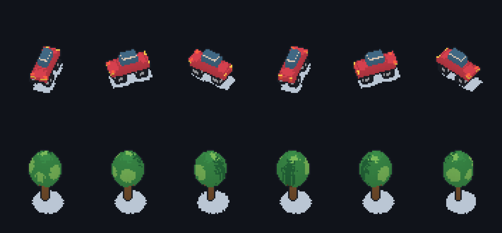

# Sprite stack

Four orthographic pixel-art views become a fake-3D sprite you can spin.



The carving is a TypeScript port of [sprite-stacking](https://github.com/danielwh2/sprite-stacking) by Daniel White, MIT License. A voxel survives only where the top, side, front, and back views all cover it. The volume is cut into a strip of flat layers, ground first. Rendering rotates each layer, squashes it for pitch, and lifts it 1px.

## What this shows about brickkit

`stack` is one TypeBox-validated action. The same function:

- runs in process, as `stack.run(...)` or `useService(sprites).stack(...)`
- is an Elysia route, `POST /api/sprites/stack`
- is callable from the typed client and from `src/cli.ts`
- is an MCP tool named `stack` on `POST /mcp`, so an agent can make a rotatable pixel-art car

`defineTool({ http: true })` publishes the HTTP route and the MCP tool from that one definition. OpenAPI lists it too.

## Run

From the repository root, after `bun install` and `bun run build`:

```sh
bun test examples/sprites
bun run --cwd examples/sprites dev
```

Open http://localhost:4310. The car loads on its own. Click **Tree**, or drop a sheet of your own: top, side, front, back, in one row. Drag the sprite to turn it. Arrow keys step the angle.

```sh
bun run --cwd examples/sprites cli -- car
bun run --cwd examples/sprites cli -- tree --slices 24 --out ./sprite-out
bun run --cwd examples/sprites cli -- car --url http://localhost:4310
```

The first two call the action in process and write `strip.png` (ground slice on the left) and `sheet.png` (16 directions). `--url` uses the typed HTTP client against a running server.

`brick dev examples/sprites/src/app.ts` works as well. The entry exports the app and does not call `listen`.

## HTTP

```sh
curl -s -X POST localhost:4310/api/sprites/stack \
  -H 'content-type: application/json' \
  -d '{"sample":"car","slices":16}'
```

The JSON has `stripPng` and `sheetPng`, both base64. Options:

| Field      | What it does                                                   |
| ---------- | -------------------------------------------------------------- |
| `sample`   | `car` or `tree`. Ignored when `sheet` is set.                  |
| `sheet`    | A 4-view PNG, base64 or a data URL.                            |
| `slices`   | Layer count, up to 96. `0` keeps the sheet height.             |
| `round`    | Lathe each solid layer into an ellipse. Trees, pots, balloons. |
| `palette`  | Shared palette size. `0` keeps every color.                    |
| `shade`    | Darken side faces toward the ground, `0` to `1`.               |
| `order`    | `reading` (top, side, front, back) or `auto`.                  |
| `sideNose` | `left` or `right`.                                             |
| `topNose`  | `auto`, `up`, or `down`.                                       |

## MCP

Point Claude Code or Cursor at `http://localhost:4310/mcp`. The tool is `stack`. This call returns the slice strip and the turntable sheet:

```json
{ "sample": "car" }
```

Ask the agent for a rotatable pixel-art car. It can pass a sheet it drew, or start from the bundled ones.

## Samples

`samples/car.png` and `samples/tree.png` are drawn by `src/samples.ts`, so the demo runs with nothing to download. Regenerate them, and `media/turntable.png`, with:

```sh
bun run --cwd examples/sprites media
```

Sheets should be 8-bit PNG, transparent or on a flat background, at most 768 pixels on a side.
